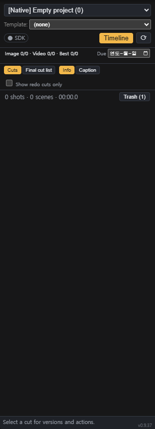

# comfyui-gonggan-cut

**A shot list + rough-cut timeline that lives inside ComfyUI.**
Plan a short film as projects, scenes and cuts, open each cut's workflow on the canvas with one click, keep every take, pick the best one, and watch the whole edit play back on a timeline - without leaving ComfyUI.

> Built for the Comfy **Open Source Higgsfield** challenge. Everything runs locally on your own ComfyUI.


## Quickstart (60 seconds)

1. Open the **Shots** tab in the left sidebar.
2. **New Project…** (project selector menu) - name the project and confirm defaults in the dialog.
3. Right-click the cut list - **Add Cut**.
4. Click a cut - its workflow opens on the canvas. Press **Run** in ComfyUI when you are ready.
5. When the render finishes, **Send last output** attaches it as a take. Mark one take as **Best**.
6. Open **Timeline** (header button or press **T**) to play the rough cut and trim clips.

## What it does

- **Shots sidebar tab** - projects, scenes, and cuts with thumbnails, drag-to-reorder, and **per-scene cut labels** (`1-1`, `1-2`, `2-1`, …) derived from scene blocks and timeline order.
- **One click, one workflow** - clicking a cut opens that cut's workflow in a single reusable canvas tab (labelled `Project / Cut`). Unsaved edits are auto-saved when you switch cuts.
- **Takes / versions** - *Send last ComfyUI output* attaches your latest render to the cut that queued it. Every take is kept; mark one as **Best**.
- **Timeline bottom panel** - toggle with the **Timeline** button or **T**. All cuts in order on one track, trim handles, playback of the picked takes as a continuous rough cut.
- **Production tracking** - summary bar `Image a/N · Video b/N · Best c/N`, project completion %, due date, *Needs redo* flag, **Show redo cuts only** filter, 3-second rule warning (with *End card* exemption).
- **Caption field** - one text area per cut for director notes and dialogue (placeholder includes the project caption language). **Info** vs **Caption** list modes change layout only; **Export captions (.srt)** uses stored caption text only, timed from cut order and lengths.
- **New project & Project Settings** - name, aspect/resolution preset, FPS, default cut length, default workflow template, and caption language (project selector / header context menu).
- **Auto Cut Split** - in the New Project dialog: 1. Copy the prompt and paste it into your LLM together with your story. 2. Paste the LLM's result into the box to split it into scenes and cuts (with captions and a reference name list) automatically. The preview shows e.g. `3 scenes, 12 cuts, 4 references will be created`; Create stays disabled while a line has an error.
- **Project templates** - link a saved ComfyUI workflow as the starting graph for new cuts.
- **Missing Load Image guard** - highlights `Load Image` nodes whose file is missing and blocks queueing until fixed.
- **Safe by design** - all edit data is stored inside the plugin folder; it never queues a generation on its own (you press *Run*).




## Install

Requirements: a recent ComfyUI with the new frontend (sidebar tabs / bottom panel). Python 3.10+. Optional: `ffmpeg` on PATH for video posters.

### Option A - git clone (recommended)
```bash
cd ComfyUI/custom_nodes
git clone https://github.com/passionfx-ui/comfyui-gonggan-cut.git
```
Restart ComfyUI, then refresh the browser.

### Option B - download ZIP
Download the repository ZIP, extract it into `ComfyUI/custom_nodes/comfyui-gonggan-cut`, restart ComfyUI.

No extra Python packages are needed for the core plugin (it uses ComfyUI's own `aiohttp` server).

### Optional: Comfy SDK regenerate path
The *Regenerate* button for legacy imported projects uses `comfy-sdk` in an isolated venv so ComfyUI's Python is never touched:
```bash
cd ComfyUI/custom_nodes/comfyui-gonggan-cut
python -m venv .venv-sdk
.venv-sdk/Scripts/python -m pip install comfy-sdk comfy-api-proxy   # Windows
# .venv-sdk/bin/python -m pip install comfy-sdk comfy-api-proxy     # macOS / Linux
```
Then run `start_proxy.bat` (proxy on `127.0.0.1:8189`). Regenerate is a dry run until you confirm.

## Usage

1. Open the **Shots** tab in the left sidebar.
2. Open the project selector menu - **New Project…**, set name, aspect/resolution, FPS, default cut length, template, and caption language.
3. (Optional) adjust the same fields later via **Project Settings…** in the header context menu.
4. Right-click the cut list - **Add Cut**. Add as many as you need; drag to reorder; select several and **Group** them into a scene.
5. Click a cut - its workflow opens on the canvas. Edit prompts, press **Run** yourself.
6. When the render finishes, click **Send last output** to attach it as a take. Pick the **Best** take.
7. Open the **Timeline** bottom panel (**Timeline** button or **T**) to play the rough cut, trim clip edges, and check total length.
8. Use **Caption** list mode to edit notes/dialogue per cut, then **Export captions (.srt)** from the Final cut list.


### Settings (optional)
Copy `gonggan_settings.default.json` to `gonggan_settings.json` to point `data_root` / `uid` at an external legacy project data folder (read-only import of older projects). Leave `data_root` empty to use native projects only.

## Where data is stored
Everything is written under the plugin folder (all gitignored): `projects/`, `edits/`, `versions/`, `workflows/`, `templates/`, `cache/`, `trash/`. Shot workflows are also saved through ComfyUI's workflow store under `user/default/workflows/gonggan/<project>/<cut>.json`. Deleting a project moves it to `trash/` first.

## Notes for judges / reviewers

- Runs **locally** against your ComfyUI instance; the plugin does not call out to the network for core Shots/Timeline features.
- Nothing is queued unless **you** press Run in ComfyUI (Regenerate requires an explicit confirm after a dry run).
- Project edits, versions, and cache files stay under this custom node's folder (plus ComfyUI's normal output/user workflow paths when you save or export).
- Automated tests (no GPU, no generation):
  ```bash
  node --test tests/js
  python -m unittest discover -s tests
  ```

## Development
```bash
python -m unittest discover -s tests -p "test_*.py"
node --test tests/js/*.test.mjs        # on Windows list the files explicitly
```
Headless browser checks live in `tests/e2e/` (need a running ComfyUI; they never queue generations). Detailed design notes, routes and changelog: [docs/DEVELOPMENT.md](docs/DEVELOPMENT.md).

## License
[MIT](LICENSE) - copyright holder is listed as `passionfx-ui` (GitHub org); confirm the legal holder name before public release.
