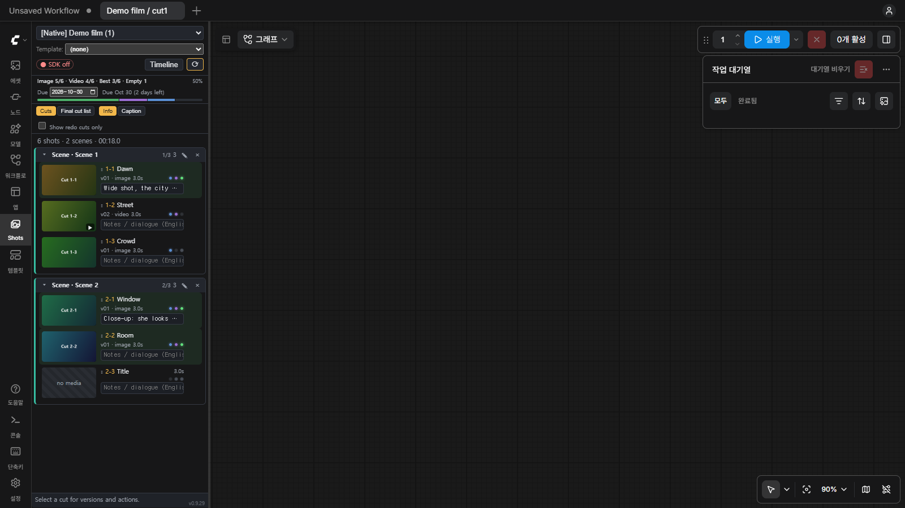
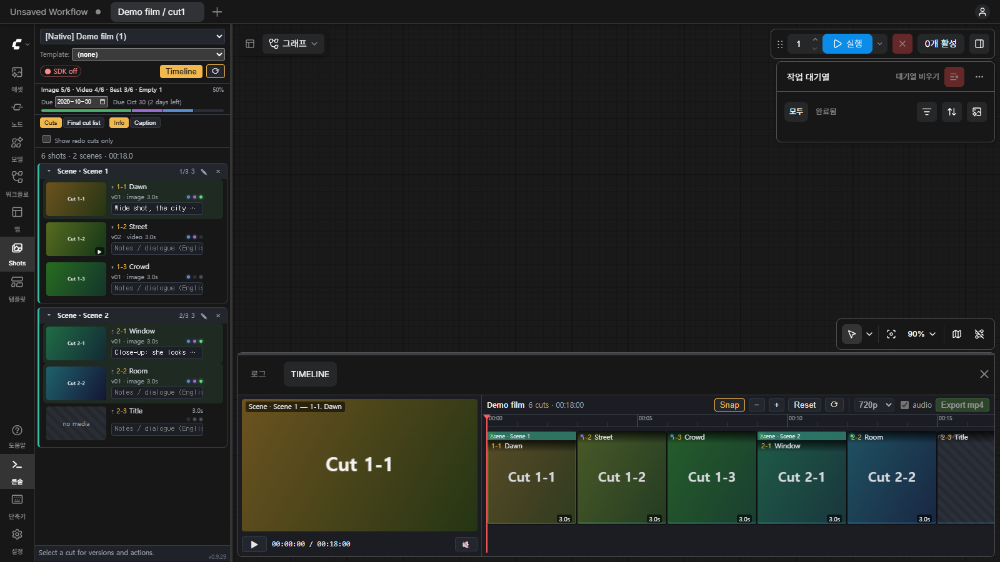

# comfyui-gonggan-cut

**A shot list + rough-cut timeline that lives inside ComfyUI.**
Plan a short film as projects, scenes and cuts, open each cut's workflow on the canvas with one click, keep every take, pick the best one, and watch the whole edit play back on a timeline — without leaving ComfyUI.

> Built for the Comfy **Open Source Higgsfield** challenge. Everything runs locally on your own ComfyUI.


<!-- TODO: screenshot — Shots sidebar (left) + Timeline bottom panel -->

## What it does

- **Shots sidebar tab** — projects → scenes → cuts, with thumbnails, drag-to-reorder and automatic cut numbers (`001`, `002`, …).
- **One click, one workflow** — clicking a cut opens that cut's workflow in a single reusable canvas tab (labelled `Project / Cut`). Unsaved edits are auto-saved when you switch cuts.
- **Takes / versions** — *Send last ComfyUI output* attaches your latest render to the cut that queued it. Every take is kept; mark one as **Best**.
- **Timeline bottom panel** — all cuts in order on one track, trim handles, playback of the picked takes as a continuous rough cut.
- **Production tracking** — Image / Video / Best status dots per cut, project completion %, due date, *Needs redo* flag and filter, 3‑second rule warning (with *End card* exemption).
- **Notes & captions** — per-cut director notes (Info mode) and dialogue (Caption mode). **Export captions (.srt)** for Premiere / DaVinci.
- **Project templates** — link a saved ComfyUI workflow as the starting graph for new cuts.
- **Missing Load Image guard** — highlights `Load Image` nodes whose file is missing and blocks queueing until fixed.
- **Safe by design** — all edit data is stored inside the plugin folder; it never queues a generation on its own (you press *Run*).


<!-- TODO: screenshot — cut rows with status dots, Info/Caption toggle -->

## Install

Requirements: a recent ComfyUI with the new frontend (sidebar tabs / bottom panel). Python 3.10+. Optional: `ffmpeg` on PATH for video posters.

### Option A — git clone (recommended)
```bash
cd ComfyUI/custom_nodes
git clone https://github.com/<OWNER>/comfyui-gonggan-cut.git
```
Restart ComfyUI, then refresh the browser.

### Option B — download ZIP
Download the repository ZIP, extract it into `ComfyUI/custom_nodes/comfyui-gonggan-cut`, restart ComfyUI.

<!-- TODO: Option C — ComfyUI-Manager / Comfy Registry once published -->

No extra Python packages are needed for the core plugin (it uses ComfyUI's own `aiohttp` server).

### Optional: Comfy SDK regenerate path
The *Regenerate* button for legacy projects uses `comfy-sdk` in an isolated venv so ComfyUI's Python is never touched:
```bash
cd ComfyUI/custom_nodes/comfyui-gonggan-cut
python -m venv .venv-sdk
.venv-sdk/Scripts/python -m pip install comfy-sdk comfy-api-proxy   # Windows
# .venv-sdk/bin/python -m pip install comfy-sdk comfy-api-proxy     # macOS / Linux
```
Then run `start_proxy.bat` (proxy on `127.0.0.1:8189`). Regenerate is a dry run until you confirm.

## Usage

1. Open the **Shots** tab in the left sidebar.
2. Right-click the project selector → **New Project…**, give it a name.
3. (Optional) choose a saved workflow in **Template:** — new cuts start from it.
4. Right-click the empty list → **Add Cut**. Add as many as you need; drag to reorder; select several and **Group** them into a scene.
5. Click a cut → its workflow opens on the canvas. Edit prompts, press **Run** yourself.
6. When the render finishes, click **Send last output** to attach it as a take. Pick the **Best** take.
7. Open the **Timeline** bottom panel to play the rough cut, trim clip edges, and check total length.
8. Switch to **Caption** mode to type dialogue, then **Export captions (.srt)** from the Final cut list.


<!-- TODO: screenshot or GIF — timeline playback with trims -->

### Settings (optional)
Copy `gonggan_settings.default.json` to `gonggan_settings.json` to point `data_root` / `uid` at an external *gonggan-share* data folder (read-only import of older projects). Leave `data_root` empty to use native projects only.

## Where data is stored
Everything is written under the plugin folder (all gitignored): `projects/`, `edits/`, `versions/`, `workflows/`, `templates/`, `cache/`, `trash/`. Shot workflows are also saved through ComfyUI's workflow store under `user/default/workflows/gonggan/<project>/<cut>.json`. Deleting a project moves it to `trash/` first.

## Development
```bash
python -m unittest discover -s tests -p "test_*.py"
node --test tests/js/*.test.mjs        # on Windows list the files explicitly
```
Headless browser checks live in `tests/e2e/` (need a running ComfyUI; they never queue generations). Detailed design notes, routes and changelog: [docs/DEVELOPMENT.md](docs/DEVELOPMENT.md).

## License
[MIT](LICENSE)